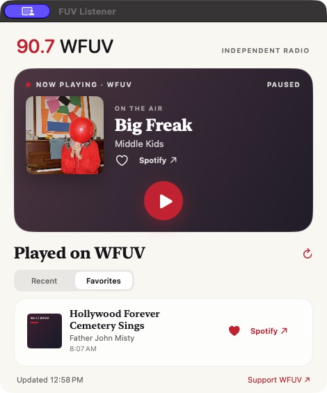
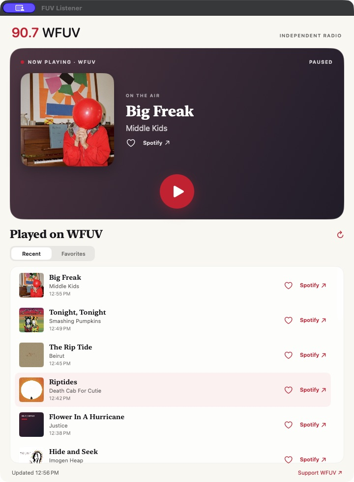
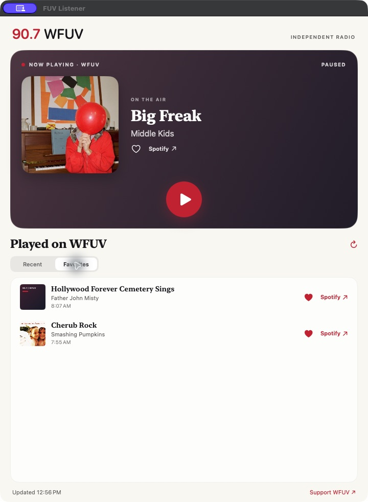

# FUV Listener for Mac

A small, native macOS player for [WFUV 90.7 FM](https://wfuv.org). The live player stays visible while the song history scrolls below it. Favorite songs locally or open any track in Spotify. The app stays in the Dock while it runs and also has a **WFUV menu bar control** for play/pause, song details, refresh, and reopening the player window.

This is an independent fan project made in support of WFUV, a great public radio resource. It is not affiliated with or endorsed by WFUV. [Support the station](https://wfuv.org/support).

## Screenshots

| Compact player | Enlarged player | Favorites |
| :---: | :---: | :---: |
|  |  |  |

See the [design review](docs/DESIGN_REVIEW.md) for the layout decisions and remaining limits.

## Build

Requires macOS 14 or later and Xcode 27. Open `FUVListenerMac.xcodeproj`, select the **FUVListenerMac** scheme and **My Mac**, then Run. To regenerate the Xcode project after editing `project.yml`, run `xcodegen generate` (XcodeGen 2.46 or later).

To launch an installed app from Terminal, use `open "/path/to/FUV Listener.app"`. An `.app` is a bundle directory, so running its path directly in a shell will fail.

The app has no account, analytics, ads, or embedded credentials. Favorites are stored in local user defaults. Cover art is fetched from the station when available, then matched against MusicBrainz and Cover Art Archive. The disk cache is limited to 80 MB and 400 images; the view model retains at most 24 images in memory. Images are resized to at most 600 pixels before caching. The feed refreshes every 45 seconds while the window is visible, or on demand with **⌘R**. Audio continues if you close the window; quit the app to stop playback. A pause shorter than 30 seconds resumes normally; after that, Play drops the old buffer and reconnects at the live edge. The app uses the high quality WFUV stream.

Network access is needed for WFUV audio and playlist data, artwork, and Spotify links. Artwork matching can occasionally miss or select a release different from the one the station played. A designed title and artist tile appears when cover art is unavailable.

## Project structure

The app is intentionally separate from the [iOS listener](https://github.com/derekg/wfuv-listener). It shares the station feed parser and bounded artwork lookup, and uses a macOS specific SwiftUI player with AVPlayer.
